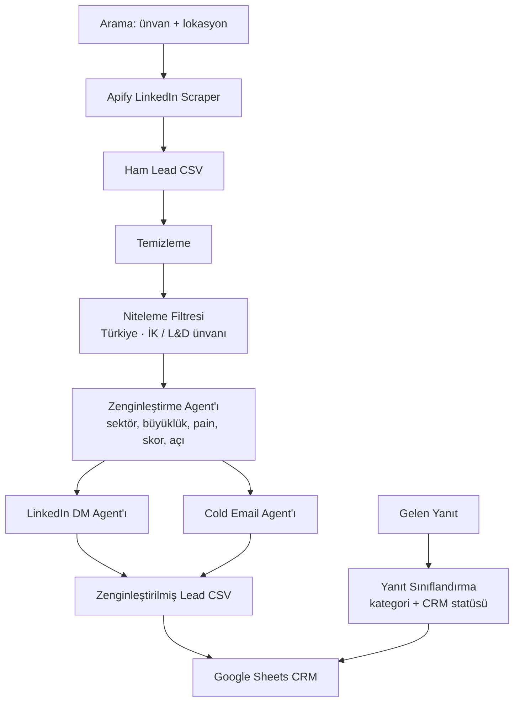

# AI Lead Pipeline

Türkiye'deki **İK profesyonellerine** ulaşmak, onları AI ile zenginleştirmek, skorlamak ve **kişiselleştirilmiş Türkçe outreach** üretmek için uçtan uca, AI destekli bir outbound prototipi — **Northwind English** (online İngilizce konuşma eğitimi) için.

---

## Sistem ne yapıyor?

1. **Toplar** — LinkedIn'den ünvan + lokasyona göre İK lead'leri çeker (Apify, çerez yok).
2. **Temizler** — tekilleştirme, normalizasyon, boş satır eleme.
3. **Niteler** — AI harcamadan ÖNCE Türkiye dışı / İK olmayan / İngilizcesi zaten iyi olanları eler.
4. **Zenginleştirir** — tek bir AI çağrısıyla: sektör, şirket büyüklüğü, uluslararası tahmini, İngilizce ihtiyaç olasılığı, İK pain point, lead skoru (1–100) ve outreach stratejisi.
5. **Yazar** — kişiselleştirilmiş **LinkedIn DM** (birincil kanal), **takip mesajı** ve **cold email** (Türkçe).
6. **Aktarır** — CRM'e hazır CSV ve (opsiyonel) **Google Sheets**.
7. **Yanıtları sınıflandırır** — gelen yanıtları kategorize edip önerilen CRM statüsü üretir.

**AI çağrı bütçesi: lead başına 3 çağrı** — 1 zenginleştirme + 1 LinkedIn DM + 1 cold email (+ opsiyonel takip / yanıt sınıflandırma).

---

## Mimari



---

## Teknoloji

Python 3.12 · OpenAI API · Apify (`apimaestro/linkedin-profile-search-scraper`) · Pandas · Pydantic · Typer + Rich · gspread / Google Sheets API

---

## Kurulum

```bash
python -m venv .venv && source .venv/bin/activate
pip install -r requirements.txt
cp .env.example .env   # ardından anahtarları doldur
```

### Ortam değişkenleri

| Değişken | Zorunlu | Not |
|---|---|---|
| `OPENAI_API_KEY` | evet | Tüm AI agent'ları için. |
| `OPENAI_MODEL` | hayır | Varsayılan `gpt-4o-mini`. Tek kaynak: `config.py`. |
| `OPENAI_TEMPERATURE` | hayır | Varsayılan `0.4`. |
| `APIFY_API_TOKEN` | `run` için | `sample` için gerekmez. |
| `APIFY_ACTOR_ID` | hayır | Varsayılan `apimaestro/linkedin-profile-search-scraper`. |
| `GOOGLE_SHEET_ID` | opsiyonel | Yoksa uyarıyla atlanır. |
| `GOOGLE_SERVICE_ACCOUNT_JSON` | opsiyonel | Service-account anahtar dosyasının yolu. |
| `MAX_LEADS` | hayır | Varsayılan `100`. |

---

## Nasıl çalıştırılır?

**Örnek mod** — tam AI pipeline'ı 5 hazır örnek lead üzerinde çalıştırır. Apify gerekmez (yalnızca OpenAI anahtarı):

```bash
python -m src.main sample
```

**Canlı mod** — Apify ile gerçek lead çeker:

```bash
python -m src.main run \
  --job-title "HR Manager" \
  --job-title "Talent Acquisition Specialist" \
  --location "Istanbul, Turkey" \
  --max-leads 100
```

Bayrak verilmezse `run`, varsayılan İK ünvanları × varsayılan Türk şehirlerini kullanır.

**Diğer komutlar:**

```bash
python -m src.main followup   # mevcut CSV'ye 2. dokunuş takip mesajı ekler (lead başına 1 AI çağrısı)
python -m src.main outreach   # DM + email + takibi yeniden üretir (örn. marka dili değişince)
python -m src.main classify   # gelen yanıtları otomatik sınıflandırır -> kategori + önerilen CRM statüsü
python -m src.main upload     # mevcut CSV'yi Google Sheets'e gönderir
```

Çıktılar:
- `data/raw/raw_leads.csv`
- `data/processed/clean_leads.csv`
- `output/enriched_leads.csv`
- `output/classified_replies.csv`

---

## Çıktı kolonları

`full_name, company, title, linkedin_url, email, location, english_proficiency, company_sector, company_size, international_company, english_training_probability, pain_point, pain_point_reason, lead_score, score_reason, outreach_angle, key_message, linkedin_dm, linkedin_followup, email_subject, email_body, crm_status`

`crm_status` varsayılanı `NEW`.

> **Tahminler hakkında:** `company_sector`, `company_size` (SMB / Mid-Market / Enterprise) ve `international_company` isim + ünvandan üretilen **AI tahminleridir** — doğrulanmış bilgi değil. `english_training_probability` 1–10; `lead_score` 1–100.

---

## Agent akışı

| Aşama | Tür | Çıktı |
|---|---|---|
| Temizleme | kural-bazlı | tekilleştirilmiş, normalize edilmiş lead'ler |
| Niteleme Filtresi | kural-bazlı | Türkiye dışı ve İK/L&D olmayan ünvanları **AI harcamadan önce** eler |
| Zenginleştirme Agent'ı | 1 AI çağrısı | sektör, büyüklük, uluslararası, İngilizce olasılığı, pain point, skor, açı, mesaj |
| LinkedIn DM Agent'ı | 1 AI çağrısı | Türkçe DM (70–120 kelime) |
| Cold Email Agent'ı | 1 AI çağrısı | Türkçe konu + gövde (100–180 kelime) |
| Yanıt Sınıflandırma Agent'ı | 1 AI çağrısı | kategori (INTERESTED/QUESTION/NOT_INTERESTED/OUT_OF_OFFICE/UNSUBSCRIBE) + sentiment + önerilen CRM statüsü + sonraki adım |

Tüm AI agent'ları `BaseAgent`'ı paylaşır (tek OpenAI client, yalnızca-JSON parse, tenacity retry). Patlayan tek bir lead loglanıp atlanır — pipeline'ı durdurmaz.

---

## Deliverability & kanallar (kapsam notları)

- **Birincil kanal LinkedIn DM.** Email **keşfi bilinçli olarak KAPALI** — tahmini/kalıp email'ler düşük kaliteli ve doğrulama katmanı olmadan teslim edilemez, bu yüzden toplamıyoruz.
- **Cold email bir outreach artifact'i olarak üretilir** (copy yeteneği), gönderim için değil. Gerçek gönderim, inbox warming ve email doğrulama (NeverBounce / ZeroBounce vb.) bu prototipin kapsamı dışında.
- Çerezsiz scraping kullanılır, böylece hiçbir LinkedIn hesabı riske atılmaz.

### Maliyet kontrolü

- Apify **profil başına** ücretlendirir, alan başına değil — kolon kısmak faturayı düşürmez. Bunun yerine arama başına `max_profiles` sınırlandırılır.
- Tekrar eden maliyet OpenAI'dır (lead başına 3 çağrı). **Niteleme filtresi zenginleştirmeden önce çalışır**, böylece kapsam dışı lead'ler (yanlış ülke, İK/L&D dışı ünvan) AI adımına hiç ulaşmaz.
- Not: Bu **B2B kurumsal** bir motion — alıcı eğitimi **ekibi için** alır, bu yüzden kişinin kendi İngilizce seviyesi bir eleme/skor kriteri **değildir** (akıcı bir HR Director hâlâ değerli bir alıcıdır).

---

## Yanıt sınıflandırma (auto-reply)

Gelen yanıtları kategorilere ayırıp önerilen CRM aksiyonu üretir — outbound döngüsünü kapatır:

```bash
python -m src.main classify   # girdi: data/sample/sample_replies.csv
```

| Yanıt | Kategori | CRM statüsü |
|---|---|---|
| "15 dk görüşelim mi?" | INTERESTED | MEETING |
| "Fiyat nedir?" | QUESTION | NURTURE |
| "İhtiyacımız yok" | NOT_INTERESTED | NOT_INTERESTED |
| "İzindeyim, döneceğim" | OUT_OF_OFFICE | FOLLOW_UP_LATER |
| "Listeden çıkarın" | UNSUBSCRIBE | DO_NOT_CONTACT |

Örnek çıktı: [`docs/sample_classified_replies.csv`](docs/sample_classified_replies.csv).

---

## Google Sheets kurulumu (opsiyonel)

1. Bir Google Cloud service account oluştur, Sheets + Drive API'lerini etkinleştir, JSON anahtarını indir.
2. Hedef sheet'i service-account e-postasıyla paylaş.
3. `.env` içinde `GOOGLE_SHEET_ID` ve `GOOGLE_SERVICE_ACCOUNT_JSON` ayarla.

Bunlar yoksa yükleme atlanır ve CSV yine çalışır.

---

## Sonuçlar (gerçek çalıştırma)

Türk İK aramalarıyla canlı bir çalıştırma:

- **180 ham profil** çekildi → **136 nitelikli lead** (100 minimumunun çok üstünde).
- Niteleme, AI harcamadan önce ~30 Türkiye dışı ve ~18 İK/L&D dışı lead'i eledi.
- 136'nın tamamında LinkedIn URL'i, kişiselleştirilmiş Türkçe **LinkedIn DM**, **takip mesajı** ve **cold email** var; 132 farklı şirket.

> Gerçek zenginleştirilmiş veri seti, gizlilik (KVKK) için **lokalde ve git-ignored** tutulur. Küçük bir **sentetik** örnek [`docs/sample_output.csv`](docs/sample_output.csv) içinde commit'lenmiştir.

## Ekran görüntüleri

> Görüntüler **sentetik örnek veriyle** üretilmiştir (gerçek kişisel veri içermez).

**Pipeline çalışırken**


**Zenginleştirilmiş lead'ler**


**Yanıt sınıflandırma**


