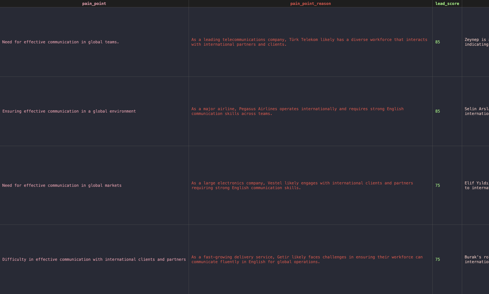
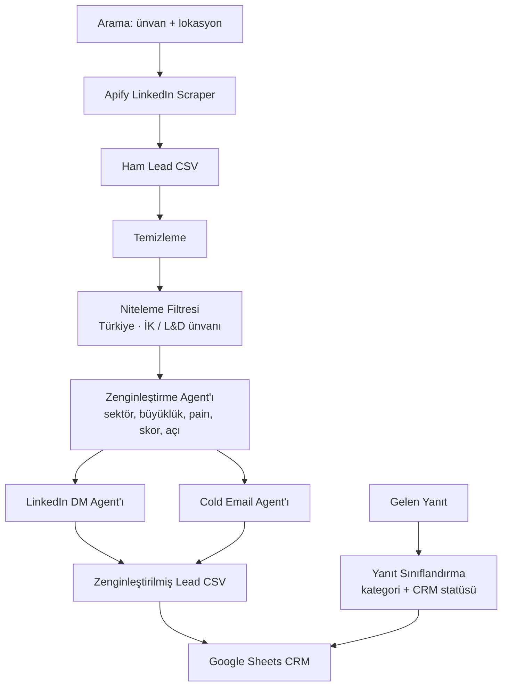
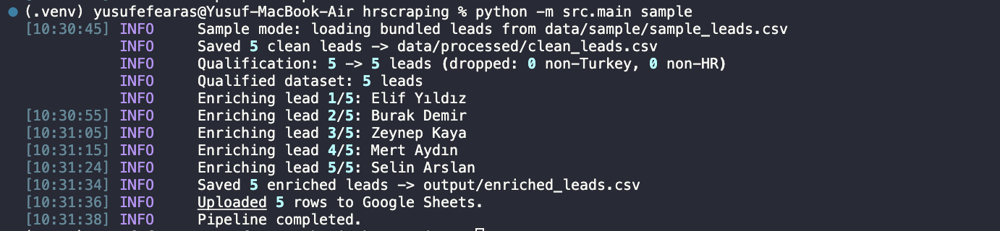
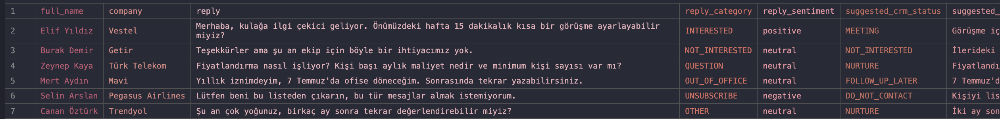

# AI Lead Pipeline

B2B satış ekipleri için hedef kitleyi bulan, her lead'i AI ile puanlayan, kişiye özel Türkçe mesaj yazan ve gelen cevapları sınıflandıran bir sistem.

Örnek senaryo: İngilizce konuşma eğitimi satan bir şirket, Türkiye'deki İK ve L&D yöneticilerine ulaşmak istiyor. Pipeline LinkedIn'den bu kişileri çeker, kapsam dışı olanları eler, kalanları skorlar ve her biri için LinkedIn DM, takip mesajı ve cold email hazırlar. Ürün bilgisi koda gömülü değil; [`config/brand.yaml`](config/brand.yaml) dosyasını değiştirerek aynı pipeline başka bir ürün için kullanılabilir.



---

## Sistem ne yapıyor?

1. **Toplar:** LinkedIn'den ünvan ve lokasyona göre lead çeker (Apify, çerez gerekmez).
2. **Temizler:** tekilleştirme, normalizasyon, boş satırları eleme.
3. **Niteler:** AI'a gitmeden önce Türkiye dışındaki ve İK/L&D dışı ünvanları kural tabanlı eler.
4. **Zenginleştirir:** tek AI çağrısıyla sektör, şirket büyüklüğü, uluslararası olma tahmini, eğitim ihtiyacı olasılığı, pain point, lead skoru (1-100) ve outreach açısı.
5. **Yazar:** kişiselleştirilmiş **LinkedIn DM** (birincil kanal), **takip mesajı** ve **cold email** (Türkçe).
6. **Aktarır:** CRM'e hazır CSV ve isteğe bağlı **Google Sheets**.
7. **Cevapları sınıflandırır:** gelen yanıtı kategorize eder, CRM statüsü ve sonraki adımı önerir.

---

## Mimari



---

## Neden bu tasarım

- **Önce ucuz filtre, sonra AI.** Temizleme ve niteleme kural tabanlı çalışır ve AI çağrısından önce gelir. Yanlış ülke ya da alakasız ünvan taşıyan bir lead hiçbir token harcatmaz. Canlı çalıştırmada 180 profilin yaklaşık 48'i bu aşamada elendi.
- **Lead başına 3 AI çağrısı bütçesi.** Zenginleştirme tek bir çağrıda yapılır (sektör, skor, pain point ve açı aynı JSON'da gelir), ardından DM ve email için birer çağrı. Takip mesajı ve yanıt sınıflandırma ayrı komutlarla, ihtiyaç olduğunda çalışır. Maliyet lead sayısıyla doğrusal ve önceden hesaplanabilir.
- **Pydantic ile doğrulanan çıktılar.** Her agent yalnızca JSON döndürür; cevap Pydantic modeline parse edilir (örneğin `company_size` yalnızca `SMB | Mid-Market | Enterprise`, `lead_score` 1-100). Geçersiz cevap tenacity ile yeniden denenir, yine olmazsa o lead loglanıp atlanır ve pipeline devam eder.
- **Marka bilgisi yapılandırmada.** Prompt'lar ürün adını, doğrulanabilir bilgileri ve imzayı `config/brand.yaml` dosyasından okur. AI'a yalnızca bu dosyadaki bilgileri kullanması söylenir, böylece uydurma iddia riski azalır.

---

## Teknoloji

Python 3.9+ · OpenAI API · Apify (`apimaestro/linkedin-profile-search-scraper`) · Pandas · Pydantic · Typer + Rich · gspread / Google Sheets API

---

## Kurulum

```bash
git clone https://github.com/Yusufefearas/ai-lead-pipeline.git && cd ai-lead-pipeline
python -m venv .venv && source .venv/bin/activate
pip install -r requirements.txt
cp .env.example .env   # ardından anahtarları doldur
```

### Ortam değişkenleri

| Değişken | Zorunlu | Not |
|---|---|---|
| `OPENAI_API_KEY` | evet | Tüm AI agent'ları için. |
| `OPENAI_MODEL` | hayır | Varsayılan `gpt-4o-mini`. Tek kaynak: `config.py`. |
| `OPENAI_TEMPERATURE` | hayır | Varsayılan `0.4`. |
| `APIFY_API_TOKEN` | `run` için | `sample` için gerekmez. |
| `APIFY_ACTOR_ID` | hayır | Varsayılan `apimaestro/linkedin-profile-search-scraper`. |
| `GOOGLE_SHEET_ID` | opsiyonel | Yoksa uyarıyla atlanır. |
| `GOOGLE_SERVICE_ACCOUNT_JSON` | opsiyonel | Service-account anahtar dosyasının yolu. |
| `MAX_LEADS` | hayır | Varsayılan `100`. |
| `BRAND_CONFIG` | hayır | Marka dosyasının yolu. Varsayılan `config/brand.yaml`. |

### Marka yapılandırması

Varsayılan dosya kurgusal bir İngilizce eğitim markası (Northwind English) içerir. Kendi ürünün için dosyayı kopyala ve `BRAND_CONFIG` ile göster:

```yaml
name: Northwind English
tagline: Online English speaking training for teams in Turkey.
facts: [...]          # ürün nedir, nasıl çalışır
proof_points: [...]   # doğrulanabilir rakamlar
proof_short: 80+ kurum, 12.000+ öğrenci
buyer_benefits: [...]
signature: Northwind English ekibi
```

---

## Nasıl çalıştırılır?

**Örnek mod:** AI pipeline'ını 5 hazır örnek lead üzerinde çalıştırır. Apify gerekmez, yalnızca OpenAI anahtarı:

```bash
python -m src.main sample
```

**Canlı mod:** Apify ile gerçek lead çeker:

```bash
python -m src.main run \
  --job-title "HR Manager" \
  --job-title "Talent Acquisition Specialist" \
  --location "Istanbul, Turkey" \
  --max-leads 100
```

Bayrak verilmezse `run`, varsayılan İK ünvanları ile varsayılan Türk şehirlerini birleştirir.

**Diğer komutlar:**

```bash
python -m src.main followup   # mevcut CSV'ye 2. temas takip mesajı ekler (lead başına 1 AI çağrısı)
python -m src.main outreach   # DM + email + takibi yeniden üretir (örn. brand.yaml değişince)
python -m src.main classify   # gelen yanıtları sınıflandırır: kategori + önerilen CRM statüsü
python -m src.main upload     # mevcut CSV'yi Google Sheets'e gönderir
```

Çıktılar:
- `data/raw/raw_leads.csv`
- `data/processed/clean_leads.csv`
- `output/enriched_leads.csv`
- `output/classified_replies.csv`



---

## Çıktı kolonları

`full_name, company, title, linkedin_url, email, location, english_proficiency, company_sector, company_size, international_company, english_training_probability, pain_point, pain_point_reason, lead_score, score_reason, outreach_angle, key_message, linkedin_dm, linkedin_followup, email_subject, email_body, crm_status`

`crm_status` varsayılanı `NEW`. Örnek çıktı: [`docs/sample_output.csv`](docs/sample_output.csv).

> **Tahminler hakkında:** `company_sector`, `company_size` (SMB / Mid-Market / Enterprise) ve `international_company` isim ve ünvandan üretilen **AI tahminleridir**, doğrulanmış bilgi değildir. `english_training_probability` 1-10, `lead_score` 1-100 aralığındadır.

---

## Agent akışı

| Aşama | Tür | Çıktı |
|---|---|---|
| Temizleme | kural tabanlı | tekilleştirilmiş, normalize edilmiş lead'ler |
| Niteleme Filtresi | kural tabanlı | Türkiye dışı ve İK/L&D dışı ünvanları **AI'dan önce** eler |
| Zenginleştirme Agent'ı | 1 AI çağrısı | sektör, büyüklük, uluslararası, eğitim ihtiyacı, pain point, skor, açı, mesaj |
| LinkedIn DM Agent'ı | 1 AI çağrısı | Türkçe DM (70-120 kelime) |
| Cold Email Agent'ı | 1 AI çağrısı | Türkçe konu + gövde (100-180 kelime) |
| Yanıt Sınıflandırma Agent'ı | 1 AI çağrısı | kategori (INTERESTED/QUESTION/NOT_INTERESTED/OUT_OF_OFFICE/UNSUBSCRIBE) + sentiment + CRM statüsü + sonraki adım |

Tüm AI agent'ları `BaseAgent`'ı paylaşır: tek OpenAI client, yalnızca JSON parse, tenacity ile retry.

---

## Kanallar ve kapsam

- **Birincil kanal LinkedIn DM.** Email keşfi bilerek kapalı: tahmin edilen email adresleri doğrulama katmanı olmadan teslim edilemez.
- **Cold email bir metin çıktısıdır**, gönderim yapılmaz. Gönderim, inbox warming ve email doğrulama (NeverBounce, ZeroBounce vb.) bu projenin kapsamı dışında.
- Çerezsiz scraping kullanılır, hiçbir LinkedIn hesabı riske girmez.
- Bu bir **B2B kurumsal** satış senaryosu: alıcı eğitimi **ekibi için** satın alır. Bu yüzden kişinin kendi İngilizce seviyesi skoru etkilemez; akıcı İngilizce konuşan bir HR Director hâlâ değerli bir alıcıdır.

### Maliyet kontrolü

- Apify **profil başına** ücretlendirir, alan başına değil. Kolon kısmak faturayı düşürmez, bunun yerine arama başına `max_profiles` sınırlanır.
- Tekrarlayan maliyet OpenAI tarafındadır (lead başına 3 çağrı) ve niteleme filtresi bunu doğrudan düşürür.

---

## Yanıt sınıflandırma

Gelen yanıtları kategorilere ayırır ve CRM aksiyonu önerir:

```bash
python -m src.main classify   # girdi: data/sample/sample_replies.csv
```

| Yanıt | Kategori | CRM statüsü |
|---|---|---|
| "15 dk görüşelim mi?" | INTERESTED | MEETING |
| "Fiyat nedir?" | QUESTION | NURTURE |
| "İhtiyacımız yok" | NOT_INTERESTED | NOT_INTERESTED |
| "İzindeyim, döneceğim" | OUT_OF_OFFICE | FOLLOW_UP_LATER |
| "Listeden çıkarın" | UNSUBSCRIBE | DO_NOT_CONTACT |

Örnek çıktı: [`docs/sample_classified_replies.csv`](docs/sample_classified_replies.csv).



---

## Google Sheets kurulumu (opsiyonel)

1. Bir Google Cloud service account oluştur, Sheets ve Drive API'lerini etkinleştir, JSON anahtarını indir.
2. Hedef sheet'i service-account e-postasıyla paylaş.
3. `.env` içinde `GOOGLE_SHEET_ID` ve `GOOGLE_SERVICE_ACCOUNT_JSON` ayarla.

Bunlar yoksa yükleme atlanır, CSV yine üretilir.

---

## Sonuçlar (canlı çalıştırma)

Türkiye'deki İK aramalarıyla yapılan bir çalıştırma:

- **180 ham profil** çekildi, **136 nitelikli lead** kaldı.
- Niteleme, AI'dan önce yaklaşık 30 Türkiye dışı ve 18 İK/L&D dışı lead'i eledi.
- 136 lead'in tamamında LinkedIn URL'i, Türkçe **LinkedIn DM**, **takip mesajı** ve **cold email** var; 132 farklı şirket.

> Gerçek veri seti gizlilik (KVKK) nedeniyle yalnızca yerelde tutulur ve git'e eklenmez. Repodaki örnekler ve ekran görüntüleri **sentetik veriyle** üretilmiştir.
